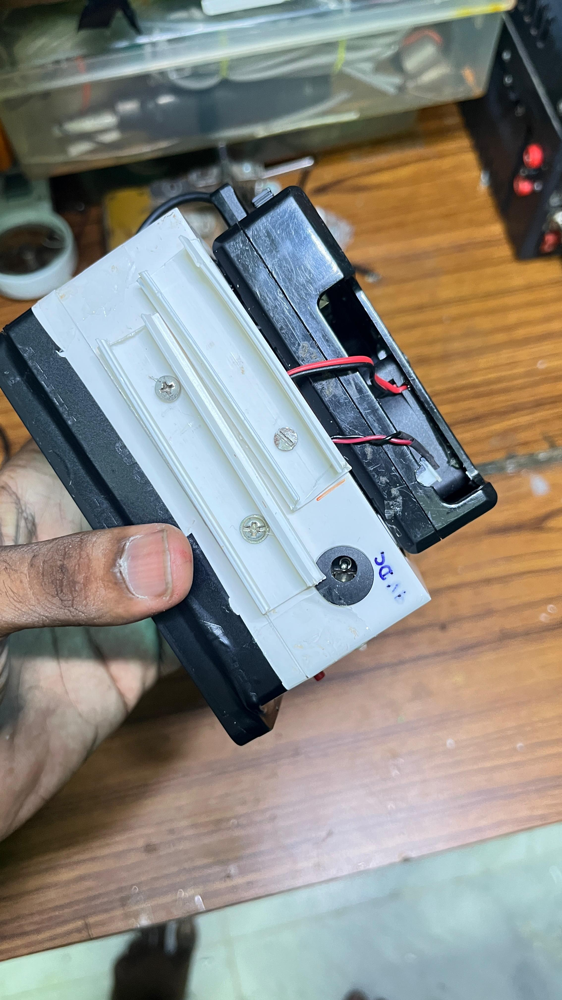
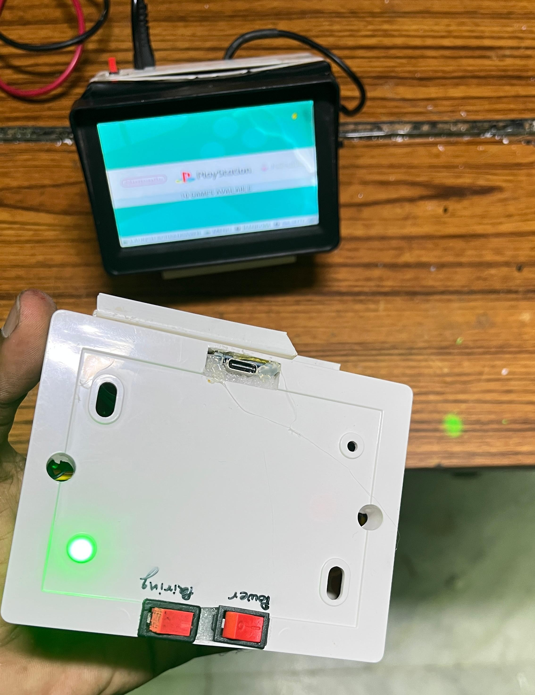

# 🕹️ DIY Modular RetroPie Handheld Console & Custom Bluetooth Gamepad

[](https://www.raspberrypi.com/)
[](https://retropie.org.uk/)
[](https://www.espressif.com/)
[](https://en.wikipedia.org/wiki/Class-D_amplifier)
[](https://opensource.org/licenses/MIT)

A fully custom, modular retro gaming handheld built from the ground up using upcycled materials, a **Raspberry Pi 3B** running **RetroPie**, a vintage CRT-aesthetic **5-inch composite video display**, and a scratch-built **ESP32 Bluetooth Low Energy (BLE) Gamepad** with dual analog joysticks and 16 inputs.

The console and gamepad feature a custom **quick-release sliding rail mechanism** that allows you to play either in unified handheld mode or detach the controller for tabletop/wireless couch gaming.

---

## 📸 Photo Gallery & Build Showcase

| Handheld Mode (Connected) | Wireless Tabletop Mode (Detached) |
| :---: | :---: |
|  |  |

| Raspberry Pi 3B Core | Tabletop Stand Mode |
| :---: | :---: |
|  |  |

| Gamepad Internal Electronics (ESP32) | Console Internal Electronics & Power |
| :---: | :---: |
|  |  |

| Bottom Profile & Fasteners | Rear View & Venting |
| :---: | :---: |
|  |  |

---

## ⚡ Hardware Architecture & Power Delivery

```text
+-----------------------------------------------------------------------------------+
|                              HANDHELD CONSOLE UNIT                                |
|                                                                                   |
|  [4x 18650 Li-ion Cells (2S2P, 7.4V 5200mAh)] ---> [2S 20A BMS Protection Board]  |
|                                                              |                    |
|                                                              v                    |
|                                                    [XL4015 Buck Converter]        |
|                                                    (7.4V -> High-Efficiency 5.1V) |
|                                                              |                    |
|         +----------------------------------------------------+                    |
|         |                     |                      |                            |
|         v                     v                      v                            |
|  [Raspberry Pi 3B]     [5" Composite LCD]     [PAM8403 Audio Amp]                 |
|  (RetroPie Emulators)  (3.5mm TRRS Video)     (3W Speaker Sound)                  |
+-----------------------------------------------------------------------------------+
                                        |
                            Quick-Release Slide Rail
                                        |
+-----------------------------------------------------------------------------------+
|                        WIRELESS BLUETOOTH GAMEPAD UNIT                            |
|                                                                                   |
|  [3.7V Li-ion Cell] ---> [TP4056 USB-C Charger] ---> [ESP32 Dev Module (BLE HID)]  |
|                                                              |                    |
|             +------------------------------------------------+                    |
|             |                                                                     |
|             v                                                                     |
|  * 2x Analog Thumbsticks (ADC Axis with Deadzone & Smoothing)                     |
|  * 16 Tactile Switches (D-Pad, ABXY, L1, R1, Start, Select)                       |
|  * Status LED Indicator                                                           |
+-----------------------------------------------------------------------------------+
```

---

## 🎮 Gamepad Firmware & Pinout (`dualpad2.ino`)

The wireless gamepad is powered by an **ESP32** utilizing the [`ESP32-BLE-Gamepad`](https://github.com/lemmingDev/ESP32-BLE-Gamepad) library, recognized natively by RetroPie / Linux as a standard Bluetooth Wireless Gamepad:

### 1. Analog Thumbsticks
| Axis | ESP32 GPIO | Calibration / Filtering |
| :--- | :---: | :--- |
| **Left Stick X (`JOY1_X`)** | `GPIO 15` | Deadzone: 300, Exponential Smoothing Factor: 0.2 |
| **Left Stick Y (`JOY1_Y`)** | `GPIO 4` | Center Calibrated at 1858 |
| **Right Stick X (`JOY2_X`)**| `GPIO 34` | ADC1 Input Only |
| **Right Stick Y (`JOY2_Y`)**| `GPIO 35` | ADC1 Input Only |

### 2. Digital Buttons & Switches (Active-LOW with Internal Pull-Ups)
| Button Label | ESP32 GPIO | Gamepad HID Button Index |
| :--- | :---: | :---: |
| **Button A** | `GPIO 23` | Button 1 |
| **Button B** | `GPIO 22` | Button 2 |
| **Button C** | `GPIO 21` | Button 3 |
| **Button D** | `GPIO 19` | Button 4 |
| **Button E** | `GPIO 18` | Button 5 |
| **Button F** | `GPIO 5` | Button 6 |
| **Button G** | `GPIO 26` | Button 7 |
| **Button H** | `GPIO 27` | Button 8 |
| **Button I** | `GPIO 32` | Button 9 |
| **Button J** | `GPIO 33` | Button 10 |
| **Button K** | `GPIO 25` | Button 14 |
| **Button L** | `GPIO 12` | Button 11 |
| **Button M** | `GPIO 14` | Button 12 |
| **Button N** | `GPIO 13` | Button 13 |
| **Left Shoulder (L1)** | `GPIO 16` | Button 15 |
| **Right Shoulder (R1)** | `GPIO 17` | Button 16 |
| **Bluetooth Status LED** | `GPIO 2` | Active indicator for pairing state |

---

## 🛠️ Materials & Bill of Components (BOM)

| Component | Specification | Purpose |
| :--- | :--- | :--- |
| **Single Board Computer** | Raspberry Pi 3 Model B (Quad-Core 1.2 GHz) | Core emulator host running RetroPie |
| **Display** | 5.0" NTSC/PAL Composite Car TFT LCD | 4:3 CRT-aesthetic retro display |
| **Gamepad Controller** | ESP32 NodeMCU Dev Board | Bluetooth HID controller transmission |
| **Main Battery Pack** | 4x 18650 Li-ion cells (2600 mAh each) | 2S2P 7.4V 5200 mAh main power bank |
| **Battery Management** | 2S 20A Li-ion BMS | Overcharge, overdischarge & short-circuit safety |
| **Voltage Regulator** | XL4015 5A DC-DC Step-Down Buck Converter | Regulates 7.4V pack to steady 5.1V for Pi & Display |
| **Audio Amplifier** | PAM8403 2×3W Class-D Stereo Module | High-efficiency speaker driver |
| **Speaker** | 40mm 4Ω 3W Dynamic Speaker | On-board sound output |
| **Gamepad Battery** | 3.7V 800 mAh Li-Po Cell + TP4056 Charger | Independent controller power supply |
| **Enclosures** | High-impact electrical switch boxes & PVC trunking | Upcycled modular chassis and slide-rail latch |

---

## 🕹️ Emulation Capabilities

Powered by **RetroPie (EmulationStation + RetroArch)**, this console supports full-speed hardware emulation for:
- **Sony PlayStation 1 (PSX)**
- **Nintendo Game Boy / Color / Advance (GBA)**
- **Super Nintendo Entertainment System (SNES)**
- **Sega Genesis / Mega Drive**
- **Nintendo Entertainment System (NES)**
- **Arcade / MAME / Neo Geo**

---

## 💻 Flashing the Gamepad Controller (`dualpad2.ino`)

1. Open Arduino IDE and install the **ESP32 board package**.
2. Install the **ESP32-BLE-Gamepad** library from GitHub:
   ```bash
   git clone https://github.com/lemmingDev/ESP32-BLE-Gamepad.git
   ```
3. Open [`dualpad2.ino`](dualpad2.ino).
4. Connect the ESP32 via USB and select **ESP32 Dev Module**.
5. Upload the sketch.
6. On your RetroPie console, go to **RetroPie Setup** $\rightarrow$ **Configuration / Tools** $\rightarrow$ **Bluetooth** $\rightarrow$ **Pair with DualStick Gamepad**.
7. Map buttons in EmulationStation and enjoy!

---

## 📄 License

Distributed under the [MIT License](LICENSE).
