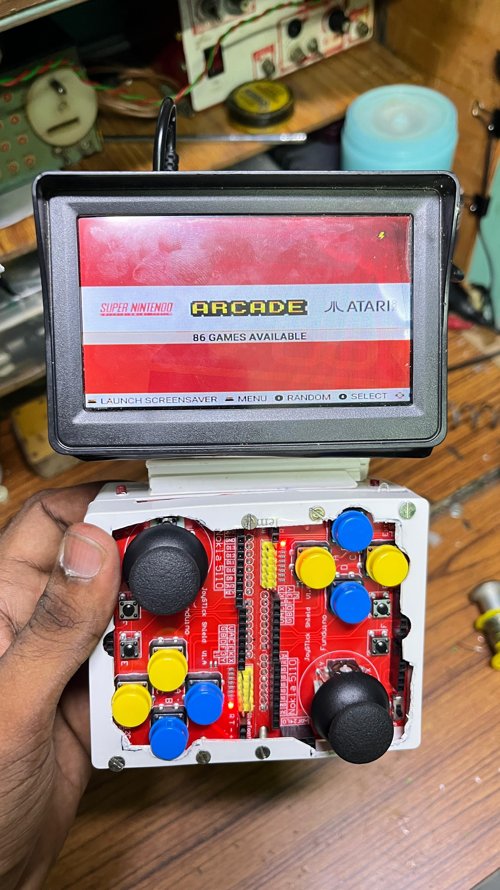
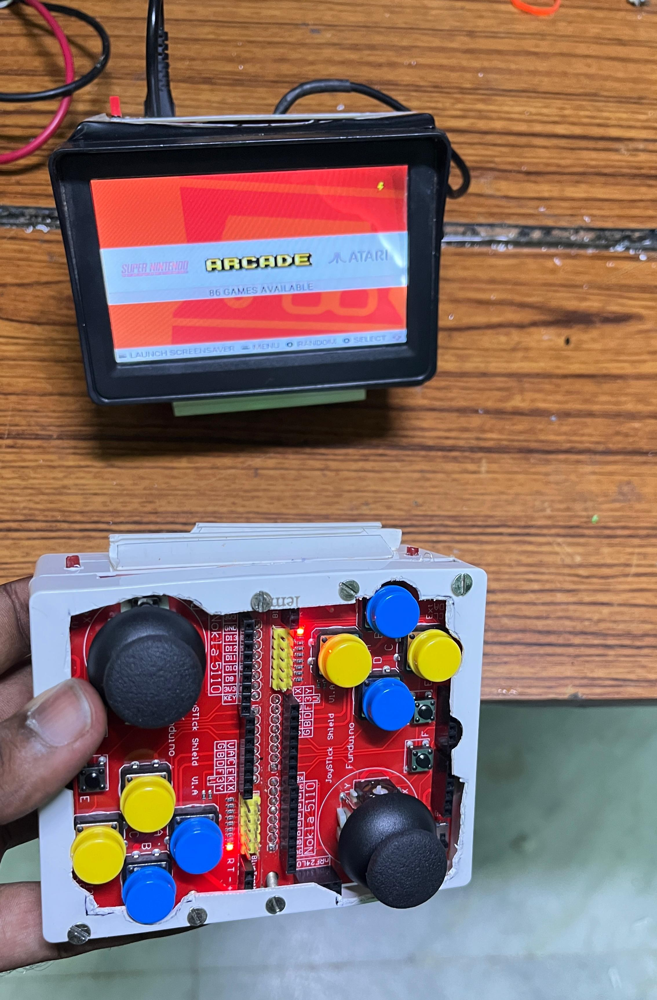
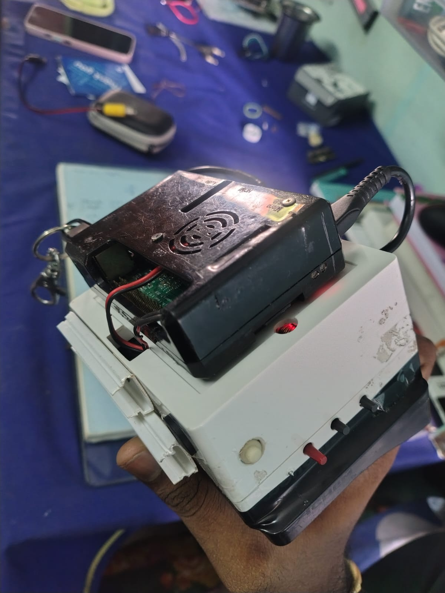
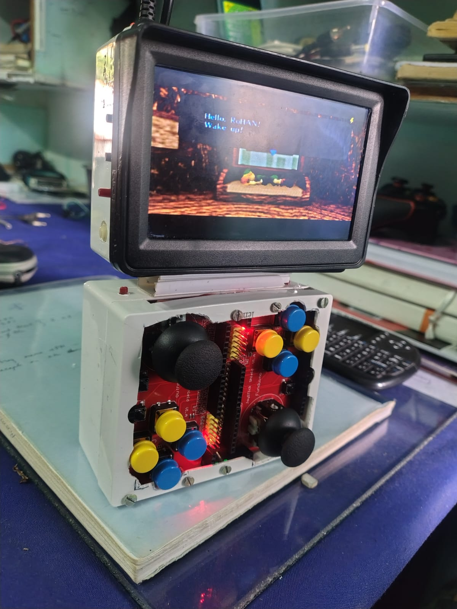
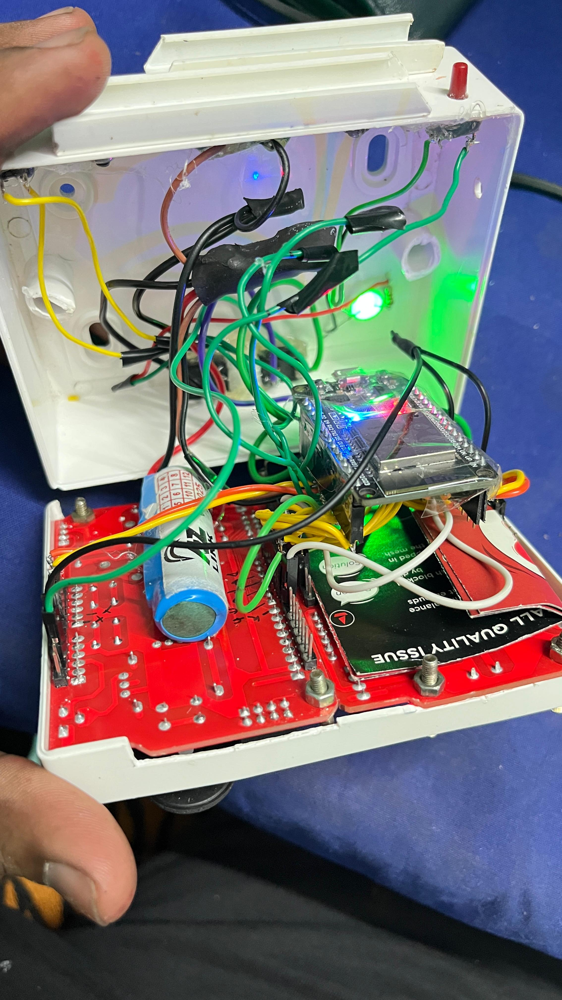
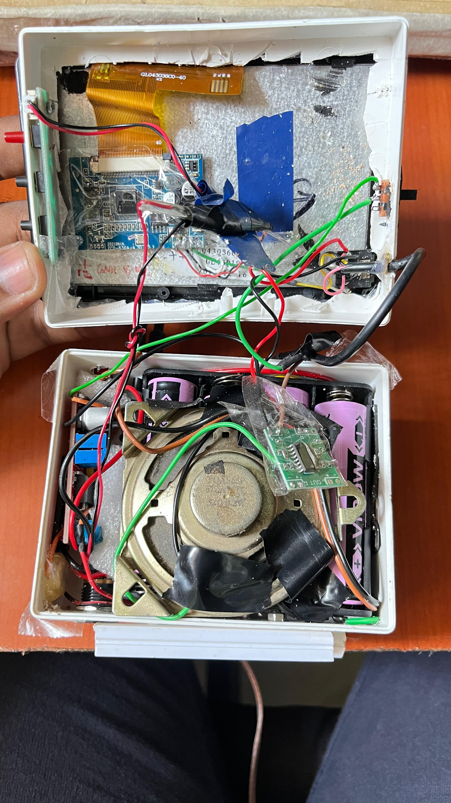

# 🕹️ DIY Modular RetroPie Handheld Console & Custom Bluetooth Gamepad

[](https://www.raspberrypi.com/)
[](https://retropie.org.uk/)
[](https://www.espressif.com/)
[](https://en.wikipedia.org/wiki/Class-D_amplifier)
[](LICENSE)

A scratch-built, modular retro gaming handheld console engineered with a **Raspberry Pi 3B** running **RetroPie / EmulationStation**, an analog **5-inch composite video display**, high-efficiency **PAM8403 stereo audio**, and a completely custom **ESP32 Bluetooth Low Energy (BLE) Gamepad**.

The console incorporates an innovative **quick-release sliding rail mechanical dock**:
- **Handheld Mode**: Slide the gamepad directly onto the console chassis for a unified portable console.
- **Tabletop / Wireless Mode**: Slide the gamepad off with a click, prop the console on its kickstand, and play from across the room via Bluetooth.

---

## 📸 Photo Gallery & Build Showcase

The repository contains high-resolution build photos documenting the engineering from bare wiring to finished enclosure:

| Assembly & Electronics | Detachable Dock Mechanism | Complete Handheld In-Action |
| :---: | :---: | :---: |
|  |  |  |
|  |  |  |

---

## ⚡ System Architecture & Hardware Stack

```text
+---------------------------------------------------------------------------------+
|                       MODULAR RETROPIE SYSTEM OVERVIEW                         |
+---------------------------------------------------------------------------------+

  +-------------------------------------+       +-------------------------------+
  |        RETROPIE CONSOLE UNIT        |       |    WIRELESS BLUETOOTH GAMEPAD |
  |                                     |       |                               |
  |  [Raspberry Pi 3B Single Board PC]  | <===~ |  [ESP32 Dual-Core BLE MCU]    |
  |  • RetroPie / RetroArch / Emulators |  BLE  |  • NimBLE / BleGamepad HID    |
  |  • EmulationStation Frontend        |       |  • 16 Tactile Action Buttons  |
  |                                     |       |  • Dual Micro-Switch D-Pads   |
  |  [5-Inch Composite Video Display]   |       |  • L1, R1 Shoulder Bumpers    |
  |  • 4:3 Vintage Aspect Ratio         |       |  • Status Blue Pairing LED    |
  |  • Direct RCA Composite Signal      |       |                               |
  |                                     |       |  [Independent Battery / LDO] |
  |  [PAM8403 Class-D Stereo Amplifier] |       +-------------------------------+
  |  • Dual 3W 4Ω Mini Speakers         |                       |
  |  • Analog Volume Potentiometer      |                       |
  |                                     |                       v
  |  [Power Supply & Boost Regulation]  |       [Quick-Release Slide Rail Dock]
  |  • Lithium-Ion 18650 Battery Pack   | <===> (Locks gamepad to console or
  |  • TP4056 USB-C Charging Unit       |        detaches for wireless play)
  |  • MT3608 5V @ 2.5A Step-Up Boost   |
  +-------------------------------------+
```

---

## 🎮 ESP32 Bluetooth Gamepad Pinout (`dualpad2.ino`)

The custom gamepad is powered by an ESP32 microcontroller running the `BleGamepad` library, presenting itself to RetroPie as a standard Bluetooth HID Gamepad device:

| Action / Button Name | ESP32 GPIO | Gamepad HID Button ID | Wiring Configuration |
| :--- | :---: | :---: | :--- |
| **Button A** | `GPIO 23` | Button 1 | Active LOW (Internal Pull-Up) |
| **Button B** | `GPIO 22` | Button 2 | Active LOW (Internal Pull-Up) |
| **Button C** | `GPIO 21` | Button 3 | Active LOW (Internal Pull-Up) |
| **Button D** | `GPIO 19` | Button 4 | Active LOW (Internal Pull-Up) |
| **Button E** | `GPIO 18` | Button 5 | Active LOW (Internal Pull-Up) |
| **Button F** | `GPIO 5`  | Button 6 | Active LOW (Internal Pull-Up) |
| **Button K** | `GPIO 25` | Button 14| Active LOW (Internal Pull-Up) |
| **Button G** | `GPIO 26` | Button 7 | Active LOW (Internal Pull-Up) |
| **Button H** | `GPIO 27` | Button 8 | Active LOW (Internal Pull-Up) |
| **Button I** | `GPIO 32` | Button 9 | Active LOW (Internal Pull-Up) |
| **Button J** | `GPIO 33` | Button 10| Active LOW (Internal Pull-Up) |
| **Button L** | `GPIO 12` | Button 11| Active LOW (Internal Pull-Up) |
| **Button M** | `GPIO 14` | Button 12| Active LOW (Internal Pull-Up) |
| **Button N** | `GPIO 13` | Button 13| Active LOW (Internal Pull-Up) |
| **Shoulder L1** | `GPIO 16` | Button 15| Active LOW (Internal Pull-Up) |
| **Shoulder R1** | `GPIO 17` | Button 16| Active LOW (Internal Pull-Up) |
| **Bluetooth Status LED** | `GPIO 2` | Indicator | HIGH = Connected, BLINK = Searching |

---

## 🛠️ Software & Firmware Setup

### 1. Gamepad Firmware (ESP32)
1. Install [Arduino IDE](https://www.arduino.cc/) with the ESP32 Board Manager.
2. Install the **ESP32-BLE-Gamepad** library by lemmingDev:
   - [ESP32-BLE-Gamepad on GitHub](https://github.com/lemmingDev/ESP32-BLE-Gamepad)
3. Open [`dualpad2.ino`](dualpad2.ino).
4. Select Board: **ESP32 Dev Module**.
5. Upload the code to your ESP32.

### 2. RetroPie Pairing & Configuration
1. Power on the Raspberry Pi running RetroPie.
2. Navigate to **RetroPie Configuration** $\rightarrow$ **Bluetooth**.
3. Put the ESP32 gamepad into pairing mode (power on).
4. Select **Register and Connect to Bluetooth Device**.
5. Select `ESP32 BLE Gamepad`. When prompted for security mode, choose `DisplayYesNo` or `NoInputNoOutput`.
6. Go back to EmulationStation, press any button on the gamepad to detect it, and map D-Pad, A/B/X/Y, and Start/Select.

---

## 📦 Bill of Materials (BOM)

| Component | Quantity | Purpose |
| :--- | :---: | :--- |
| **Raspberry Pi 3 Model B** | 1 | Single-board computer running RetroPie |
| **ESP32 NodeMCU / Dev Module** | 1 | Bluetooth Low Energy HID controller MCU |
| **5-Inch Composite LCD** | 1 | Low-latency vintage analog video monitor |
| **PAM8403 Amplifier Board** | 1 | 3W+3W Class-D miniature audio amp |
| **Miniature 4Ω 3W Speakers** | 2 | Stereo speakers |
| **Tactile Momentary Switches** | 16 | Gamepad action buttons & directional controls |
| **TP4056 USB-C Charge Module** | 1 | Lithium-ion battery charging and protection |
| **MT3608 DC-DC Step-Up Boost** | 1 | Stepping 3.7V battery voltage up to 5V @ 2.5A |
| **18650 Li-ion Cell (or LiPo Pack)** | 2 | Portable power source |
| **Sliding Rail Mechanism** | 1 Set | Quick-release lock for modular gamepad docking |

---

## 📄 License

This build is open-source hardware and software distributed under the [MIT License](LICENSE).
